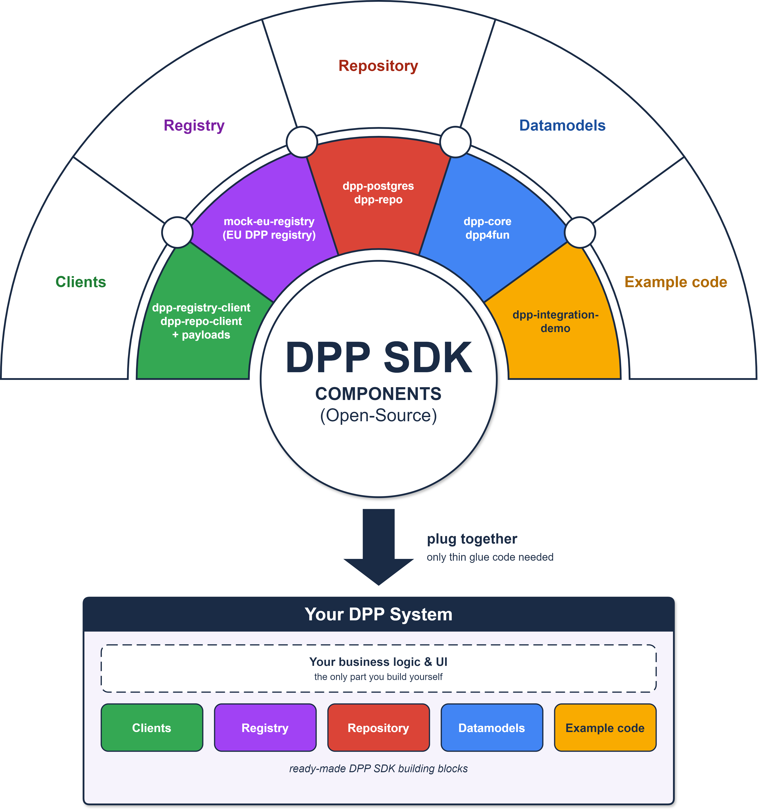
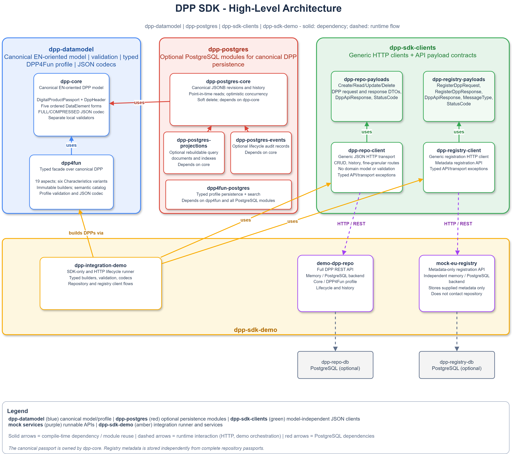

# DPP SDK (Java)

Java 17 / Maven SDK for building, validating, serializing and exchanging Digital Product Passports. Contains an EN 18223-oriented core model, a typed Cir4Fun furniture profile, optional PostgreSQL persistence, generic HTTP clients, and demo repository and registry services.

<p align="center">
  
</p>

The SDK gives you the datamodels, repository persistence, HTTP clients, a registry and runnable example code as ready-made blocks that plug together. Your business logic and UI are the only part you build yourself.

The demo services are examples, not production deployments.

Source and releases: [CIR4FUN-EU/java-dpp-sdk](https://github.com/CIR4FUN-EU/java-dpp-sdk) · [changelog](CHANGELOG.md) · [license](LICENSE)

## Standards alignment

Coverage is partial throughout. No validation result in this SDK proves legal compliance or certification.

- **EN 18219 — identifiers:** local checks for selected GS1 Digital Link and GLN methods, when the caller supplies a validation context. No issuance, online resolution or global uniqueness.
- **EN 18221 — persistence:** canonical JSONB revisions with history and point-in-time reads. Retention, backup, security and deployment are out of scope.
- **EN 18222 — APIs:** both the repository and the registry expose the standardised API as specified — EN 18222 routes, operation names, result envelopes and FULL/COMPRESSED representations — not a bespoke interface. Client code written against the standard works against them unchanged. The implemented set of operations is a selected subset, and conformance is not certified.
- **EN 18223 — DPP content:** passport header, five DataElement forms, expanded and compressed JSON, local semantic and format validation.
- **Cir4Fun D4.1:** 19 general aspects and six Characteristics variants as typed immutable views.

Known limitations and unresolved source disagreements are recorded in the [model guide](dpp-datamodel/MODEL_GUIDE.md#source-decisions-and-model-limitations). In short: compressed JSON omits some semantic metadata, so expansion is best-effort; the generic clients transport JSON without validating domain content; the demo services establish no production security or durability; and the registry records supplied identifiers without fetching repository content.

> Commands below use Bash/forward slashes, which also work in PowerShell. On Windows, use `mvnw.cmd` where a command says `./mvnw`.

## Quick start

Needs Docker with Compose v2 — no local Java or Maven. Run from the repository root:

```bash
docker compose -f dpp-sdk-demo/docker-compose.postgres.yml up -d
```

This pulls the published repository and registry images and starts each with its own PostgreSQL 16 database. Then:

| Service | Health | Swagger UI |
| --- | --- | --- |
| Repository API | [:8080/health](http://localhost:8080/health) | [:8080/swagger-ui/index.html](http://localhost:8080/swagger-ui/index.html) |
| Registry API | [:8081/health](http://localhost:8081/health) | [:8081/swagger-ui/index.html](http://localhost:8081/swagger-ui/index.html) |

Both health endpoints return JSON with `status` `UP`. Stop with `down` (add `-v` to delete the database volumes and their data):

```bash
docker compose -f dpp-sdk-demo/docker-compose.postgres.yml down
```

The command above needs no configuration; Compose carries working defaults. To change ports, image tag, storage backend or validation profile, copy `dpp-sdk-demo/.env.example` to `dpp-sdk-demo/.env` and edit it — see the [demo README](dpp-sdk-demo/README.md) for those settings and for running the services from local JARs.

## Build from source

Needs JDK 17 with `JAVA_HOME` set. The Maven wrapper is included.

```bash
./mvnw clean verify              # build and test everything
./mvnw clean install             # also install the artifacts locally
```

To build and run the demo API images from this checkout instead of the published ones:

```bash
./mvnw clean package
docker compose -f dpp-sdk-demo/docker-compose.yml up -d --build
```

## Architecture

The detailed module view behind the component overview above:



The canonical passport belongs to `dpp-core`; `dpp4fun` supplies immutable typed views over that same model. The PostgreSQL modules store complete revisions plus derived query and audit data. The HTTP clients accept JSON without depending on domain models. The demo repository stores full passports; the demo registry stores only metadata, in its own backend.

[Editable Draw.io source](docs/dpp-sdk-architecture.drawio) — both diagrams are pages in this one file.

## Modules

| Module | Responsibility | Start here |
| --- | --- | --- |
| `dpp-datamodel` | Canonical core model, validation, codecs, typed DPP4Fun profile | [README](dpp-datamodel/README.md) · [model guide](dpp-datamodel/MODEL_GUIDE.md) |
| `dpp-postgres` | Optional PostgreSQL persistence, projections, audit events | [README](dpp-postgres/README.md) |
| `dpp-sdk-clients` | Model-independent repository and registry HTTP clients | [README](dpp-sdk-clients/README.md) |
| `dpp-sdk-demo` | Demo repository service, mock registry, Docker setup, runnable integration demo | [README](dpp-sdk-demo/README.md) · [presenter guide](dpp-sdk-demo/DEMO_GUIDE.md) |

`dpp-sdk-demo` is runnable reference code, not a consumer library. For a working end-to-end flow — build a typed passport, validate, serialize, create/read/update/register over HTTP — run the integration demo's `all` mode; see the [demo README](dpp-sdk-demo/README.md#run-the-integration-demo).

## Consumer Maven artifacts

All artifacts share one version per release. Set it once and use `${dpp.version}` in every dependency:

```xml
<properties>
  <dpp.version>0.6.0</dpp.version>
</properties>
```

This table is the only place the docs name a version; the [changelog](CHANGELOG.md) lists what each release changed.

| Purpose | Maven coordinate |
| --- | --- |
| Generic DPP core | `dpp.datamodel:dpp-core` |
| Typed DPP4Fun model | `dpp.datamodel:dpp4fun` |
| PostgreSQL persistence | `dpp.postgres:dpp-postgres-core`, `dpp.postgres:dpp4fun-postgres` |
| Repository client | `dpp.client:dpp-repo-client`, `dpp.client:dpp-repo-payloads` |
| Registry client | `dpp.client:dpp-registry-client`, `dpp.client:dpp-registry-payloads` |

The module READMEs show which to pick and give usage examples. `./mvnw clean install` resolves them from this checkout.
