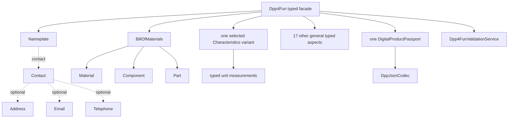
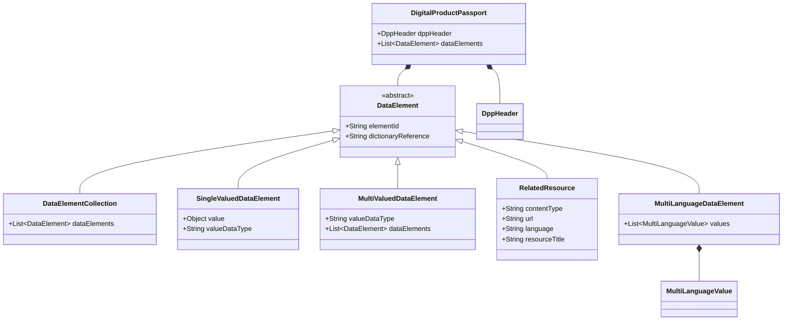

# Model and Validation Guide

This guide covers the EN 18223-oriented domain model and validation in `dpp-core`, and the Dpp4Fun typed profile facade in `dpp4fun`. Start with [README.md](README.md) for dependencies and a compact working example. Dpp4Fun stores one canonical core passport and exposes immutable typed views over its profile elements.

## How to use this guide

Read the object graph first, then find your type below. Builder checks run at `build()` time; validator rules run only when you call the relevant validator or validation service.

- [Core model and DataElement hierarchy](#en-oriented-core-model)
- [DppHeader fields](#dppheader-fields)
- [Granularity: MODEL, BATCH, ITEM](#granularity-model-batch-item)
- [Dpp4Fun model families](#dpp4fun-model-families)
- [Source decisions and model limitations](#source-decisions-and-model-limitations)
- [Validation services and boundaries](#en-18223-clause-4-semantic-validation)
- [Immutable editing](#immutable-editing)

## Dpp4Fun model graph (typed views, not separate passport storage)



`DigitalProductPassport` in `dpp-core` is the only passport root and canonical state owned by `Dpp4Fun`. `DppHeader` carries its identity and generic metadata. Named immutable D4.1 views operate directly on core `DataElement` subtrees. `Dpp4FunJsonCodec` delegates to core transport, and `Dpp4FunValidationService` composes core and profile validation. Core-representable unknown elements remain in place during typed edits. Source semantics and EN identifiers come from the bundled frozen catalog; external content-specification governance values and the Surface semantic IRI remain unresolved.

The D4.1 `Surface` and `ProfessionalUseOnly` decisions, with source evidence,
are documented in [Source decisions and model limitations](#source-decisions-and-model-limitations).
Typed profile validation does not coerce a mismatched core value.

## Core DataElement class graph



The core hierarchy follows EN 18223's five concrete DataElement variants. `DppHeader` is an SDK convenience, not an EN JSON nested type: its fields serialize onto the passport root. Each `DataElement` has a locally scoped `elementId`, an optional `dictionaryReference`, and subtype-specific content. The **FULL** codec retains element metadata and nesting; the **COMPRESSED** codec intentionally removes some of that information.

## Object graph

```text
Dpp4Fun
+-- Nameplate
|   `-- Contact (optional)
|       +-- Address (optional)
|       +-- Email (optional)
|       `-- Telephone (optional)
+-- 17 other general aspects
+-- one selected Characteristics variant
`-- BillOfMaterials
    +-- Material
    +-- Component
    `-- Part
```

## EN-oriented core model

`dpp-core` contains the immutable `DigitalProductPassport` root, with a
`DppHeader` and an ordered list of `DataElement` objects. `DppHeader` is an SDK
structural convenience, not an EN semantic class: its nine attributes correspond
to EN 18223 root attributes, and `DppJsonCodec` flattens them onto the
serialized root. Builders maintain coherent immutable Java state; they do not
run EN semantic rules.

### DppHeader fields

Seven of the nine are required. `facilityId` is optional, and
`contentSpecificationIds` may be empty but is always serialized.

| Field | Java type | Required | Notes |
| --- | --- | --- | --- |
| `digitalProductPassportId` | `String` | yes | Identifies *this passport*, not the product. `EN18223_HEADER_DPP_ID_REQUIRED`; a non-absolute-URI value adds the `EN18223_HEADER_DPP_ID_URI_RECOMMENDED` **warning**, not an error. |
| `uniqueProductIdentifier` | `String` | yes | Identifies what the passport describes, at the declared granularity. `EN18223_HEADER_PRODUCT_ID_REQUIRED`. |
| `granularity` | `Granularity` | yes | `MODEL`, `BATCH` or `ITEM` — see below. `EN18223_HEADER_GRANULARITY_REQUIRED`. |
| `dppSchemaVersion` | `String` | yes | Open string, e.g. `EN18223:2026`. `EN18223_HEADER_SCHEMA_VERSION_REQUIRED`. |
| `dppStatus` | `String` | yes | Open string, e.g. `active`; the SDK defines no status vocabulary. `EN18223_HEADER_STATUS_REQUIRED`. |
| `lastUpdated` | `Instant` | yes | Serialized via `Instant.toString()`, so UTC ISO-8601. `EN18223_HEADER_LAST_UPDATED_REQUIRED`. |
| `economicOperatorId` | `String` | yes | The responsible operator. `EN18223_HEADER_ECONOMIC_OPERATOR_ID_REQUIRED`. |
| `facilityId` | `String` | no | Omitted from JSON when null. Validated only when the caller selects the `GS1_GLN` identifier method. |
| `contentSpecificationIds` | `List<String>` | list may be empty | Emitted as an array even when empty; entries must be non-blank (`EN18223_HEADER_CONTENT_SPEC_ID_NONBLANK`) and a null entry fails serialization. |

In expanded (FULL) JSON these sit directly on the root beside `elements` — there
is no nested `header` object:

```json
{
  "digitalProductPassportId": "urn:example:dpp:chair-1",
  "uniqueProductIdentifier": "urn:example:product:chair-1",
  "granularity": "model",
  "dppSchemaVersion": "EN18223:2026",
  "dppStatus": "active",
  "lastUpdated": "2026-09-21T10:00:00Z",
  "economicOperatorId": "urn:example:operator:1",
  "facilityId": "urn:example:facility:1",
  "contentSpecificationIds": [],
  "elements": []
}
```

`DppHeader.Builder` defaults nothing: it will build a header with required
fields missing, and the omission surfaces later — `DppValidator` reports it as
an error, and `DppJsonCodec` refuses to serialize. `Dpp4Fun.builder()` is the
exception, managing `dppSchemaVersion`, a default UTC `lastUpdated`, and catalog
content-specification identifiers for you.

An empty `elements` array and an empty `contentSpecificationIds` list are both
valid, as is any `dppStatus` string.

### Granularity: MODEL, BATCH, ITEM

`granularity` states *what one passport describes*, per EN 18223 Clause 4.1.2.2. It is required: omitting it fails `DppValidator` with `EN18223_HEADER_GRANULARITY_REQUIRED`, and the codec refuses to serialize a header without it.

The header shape is the same at all three levels. There is no batch ID or item ID attribute — the nine header attributes are fixed, and `uniqueProductIdentifier` is the only identity slot. So `granularity` declares what that one identifier denotes:

| Level | `uniqueProductIdentifier` denotes | Encoded as, e.g. |
| --- | --- | --- |
| `MODEL` | the product model or type | bare GTIN |
| `BATCH` | the batch — the product identifier *is* the batch identifier | GTIN + lot (AI `10`) |
| `ITEM` | the individual unit | GTIN + serial (AI `21`) |

This is the consequence worth planning for: at `BATCH` you do not add a batch ID beside the product ID, you make the product identifier carry batch identity. The same applies at `ITEM`. If your identifier scheme cannot express the level, the passport cannot distinguish it — `granularity` alone is a declaration, not a qualifier that narrows a model-level identifier.

Because the identifier is the only thing that actually encodes the level, selected identifier methods cross-check the two. When the caller selects a method through `IdentifierValidator` and an `IdentifierValidationContext`, a disagreement is reported as `IDENTIFIER_GRANULARITY_MISMATCH`:

| Method | Level derived from the identifier |
| --- | --- |
| GS1 Digital Link | serial (AI `21`) or TPX (AI `235`) → `ITEM`; lot (AI `10`) → `BATCH`; bare GTIN → `MODEL` |
| Identification Link | item category → `ITEM`, even when batch data is present; batch plus product code → `BATCH`; product code alone → `MODEL`; no structured query → `ITEM` |

A batch-level Identification Link without a product-code category is rejected as `IDENTIFICATION_LINK_REQUIRED_IDENTIFIER_MISSING`. These checks do not run in default validation — only when identifier methods are explicitly selected.

DPP4Fun's `Nameplate.batchNumber` is profile **content**, not identity. `Dpp4Fun.builder()` never derives header identity from it, so setting it does not make a passport batch-level.

**No inheritance between levels.** Each passport stands alone. The SDK does not link an `ITEM` passport to its `BATCH` or `MODEL` parent, propagate shared values downward, or manage that hierarchy; model→batch→item inheritance is deferred beyond this release. Repeating shared content across levels, or referencing a parent passport, is the application's choice.

Serialization uses lowercase `model`, `batch`, and `item`. Reads are case-insensitive, and an unrecognized value raises `DppJsonException` naming `$.granularity`.

### DataElement types

Every `DataElement` subtype has `elementId` and optional `dictionaryReference`:

| Type | Purpose and additional attributes | EN cardinality and current validation boundary |
| --- | --- | --- |
| `DataElementCollection` | Heterogeneous ordered named children in `dataElements` | EN requires at least one child; `DppValidator` rejects empty collections. |
| `SingleValuedDataElement` | One JSON-compatible `value`; optional `valueDataType` | EN value is required and datatype is optional; null is constructible but treated as missing by semantic validation. |
| `MultiValuedDataElement` | Ordered `dataElements` sharing one concrete subtype; optional `valueDataType` | Prose says at least one while Table 4 says `0..*`; current semantic validation and expanded transport require a nonempty list. |
| `RelatedResource` | Resource metadata: `contentType`, `url`, optional `language` and `resourceTitle` | `contentType` and `url` are required; present URL, media type and language receive local syntax checks. |
| `MultiLanguageDataElement` | Ordered `values` containing `MultiLanguageValue` records | At least one entry; each entry needs a `value` and `language`; language syntax/code membership is checked locally. |
| `MultiLanguageValue` | One text `value` paired with a `language` tag | Both properties are required by semantic validation; the tag is validated by `DataFormatValidator`. |

### Choosing and constructing a DataElement

The five subclasses describe different shapes, not levels of validation. A
`DataElementCollection` groups named fields that may have different types. Use
it for a record such as a material (`name`, `mandatory`, and `portion`) or a
structured nameplate. A `MultiValuedDataElement` represents a repeated ordered
list whose entries share one concrete DataElement subtype; its optional
`valueDataType` is supplied when defined by the profile. For example, a list
of material records is a multivalue containing collection entries. It is not
interchangeable with a collection: a collection is a heterogeneous object,
while a multivalue is a homogeneous array. A
`SingleValuedDataElement` holds one JSON value. `RelatedResource` points to a
document or other resource and carries its media type and URL. A
`MultiLanguageDataElement` stores one or more language-tagged strings; use it
when each translation must remain associated with its language instead of
flattening translations into a plain string.

The following example builds all five forms and nests them in one passport.
The element IDs are local names for this example; real profile IDs and
`dictionaryReference` values must come from the applicable profile or catalog.

```java
import dppsdk.core.model.*;
import dppsdk.core.transport.json.DppJsonCodec;
import java.time.Instant;
import java.util.List;

public class CoreDataElementExample {
  public static void main(String[] args) {
    var material = new DataElementCollection.Builder().elementId("material-1")
            .dataElements(List.of(
                    new SingleValuedDataElement.Builder().elementId("name")
                            .value("Steel").valueDataType("xsd:string").build(),
                    new SingleValuedDataElement.Builder().elementId("mandatory")
                            .value(true).valueDataType("xsd:boolean").build(),
                    new SingleValuedDataElement.Builder().elementId("portion")
                            .value(2.5).valueDataType("xsd:decimal").build()))
            .build();

    var materials = new MultiValuedDataElement.Builder().elementId("materials")
            .dataElements(List.of(material)).build();
    var translations = new MultiLanguageDataElement.Builder().elementId("label")
            .values(List.of(
                    new MultiLanguageValue.Builder().language("en-US").value("Chair").build(),
                    new MultiLanguageValue.Builder().language("de-DE").value("Stuhl").build()))
            .build();
    var manual = new RelatedResource.Builder().elementId("manual")
            .contentType("application/pdf").url("https://example.test/manual.pdf")
            .language("en-US").resourceTitle("Assembly manual").build();
    var product = new DataElementCollection.Builder().elementId("product")
            .dataElements(List.of(materials, translations, manual)).build();

    var header = new DppHeader.Builder().digitalProductPassportId("urn:example:dpp:1")
            .uniqueProductIdentifier("urn:example:product:1").granularity(Granularity.MODEL)
            .dppSchemaVersion("1.0").dppStatus("active")
            .lastUpdated(Instant.parse("2026-01-01T00:00:00Z"))
            .economicOperatorId("urn:example:operator:1").contentSpecificationIds(List.of())
            .build();
    var passport = new DigitalProductPassport.Builder().dppHeader(header)
            .dataElements(List.of(product)).build();
    String fullJson = new DppJsonCodec().toExpandedJson(passport);
  }
}
```

The corresponding expanded structure (omitting the header here) is:

```json
{
  "elementId": "product",
  "objectType": "DataElementCollection",
  "elements": [
    {
      "elementId": "materials",
      "objectType": "MultiValuedDataElement",
      "value": [
        {
          "elementId": "material-1",
          "objectType": "DataElementCollection",
          "elements": [
            {"elementId":"name","objectType":"SingleValuedDataElement","valueDataType":"xsd:string","value":"Steel"},
            {"elementId":"mandatory","objectType":"SingleValuedDataElement","valueDataType":"xsd:boolean","value":true},
            {"elementId":"portion","objectType":"SingleValuedDataElement","valueDataType":"xsd:decimal","value":2.5}
          ]
        }
      ]
    },
    {
      "elementId": "label",
      "objectType": "MultiLanguageDataElement",
      "value": [
        {"value":"Chair","language":"en-US"},
        {"value":"Stuhl","language":"de-DE"}
      ]
    },
    {
      "elementId":"manual","objectType":"RelatedResource",
      "contentType":"application/pdf","url":"https://example.test/manual.pdf",
      "language":"en-US","resourceTitle":"Assembly manual"
    }
  ]
}
```

`MultiValuedDataElement.valueDataType` is optional in the core builder. For a
list of composite records, the DPP4Fun catalog identifies the expected item
shape; the BOM binding currently leaves the list-level datatype unspecified.
The JSON excerpt is a shape illustration rather than a complete standalone
passport payload.

Core cardinalities and validation boundaries are summarized here before the
validator details below. Header requirements, element identifiers and
subtype-required properties are checked by `DppValidator`; collection,
multivalue and multilingual lists must be nonempty for expanded transport.
`RelatedResource.contentType` and `url` are required. A collection may mix
different child types, while each multivalue must contain one concrete child
type. Clause 4.1.2.6 has a source conflict on whether a multivalue may be empty;
the current semantic validator follows the prose and rejects an empty list.

Lists are defensively copied and exposed as unmodifiable values. The single
value supports null, strings, booleans, JSON-compatible numbers, lists, and
string-keyed maps, and recursively freezes lists and maps. Builders and
`toBuilder()` create new values. `SingleValuedDataElement.value == null` is
constructible, but cannot distinguish an explicitly supplied JSON null from a
value omitted by the builder. The semantic validator treats it as missing to
honor Table 3's `[1]` cardinality.

### EN 18223 Clause 4 semantic validation

`dppsdk.core.validation.DppValidator` validates mandatory Clause 4 semantics
independently of JSON transport and returns all findings in an immutable
`ValidationResult`. Each `ValidationIssue` contains a deterministic model path,
a stable rule key, and a message. Findings are ordered by header fields, then
depth-first element traversal. The validator checks required header state,
required element IDs and sibling uniqueness, required subtype fields,
non-empty collections/multivalues/language lists, and homogeneous concrete
subtypes in a `MultiValuedDataElement`.

An empty passport root element list and empty `contentSpecificationIds` list
are valid. `dppStatus` remains open; the listed status values are examples.
The recommended URI/URL basis for `digitalProductPassportId` and recommended
DPP-wide element-ID uniqueness are not hard errors. Local uniqueness at every
tree scope together with the tree structure makes absolute element paths
unique; no separate global path index is needed. A collection may include a
`MultiLanguageDataElement` as an additional child, because Clause 4.1.2.3
defines it as a concrete subtype and Clause 4.1.2.4 does not prohibit it.
However, it must also contain at least one of the child types enumerated in
Clause 4.1.2.4 (`DataElementCollection`, `SingleValuedDataElement`,
`MultiValuedDataElement`, or `RelatedResource`); a `MultiLanguageDataElement`
alone does not meet that requirement.

Clause 4.1.2.6 remains internally inconsistent: its prose says a
`MultiValuedDataElement` contains at least one child, while Table 4 gives
`[0..*]`. The validator follows the prose and rejects an empty list.

This validator checks semantic presence/cardinality; it does not provide full
EN validation. Identifier profiles and generic local field/value formats are
handled by separate APIs. Legal-act/product profiles, repository/global
uniqueness and lifecycle/history remain later system or profile work. SHOULD
recommendations and examples are not promoted into mandatory semantic
failures.

### Generic local format validation

`dppsdk.core.validation.format.DataFormatValidator.validate(passport)` returns
the shared immutable `ValidationResult` and checks only present format-bearing
values. Missing values remain `DppValidator` semantic findings. The formatter
does not call `DppValidator`, identifier validation, or the JSON codec.

It checks:

- present `RelatedResource.url` values against absolute RFC 3986 URI syntax,
  without requiring HTTP, DNS, reachability, or resource existence;
- present `RelatedResource.contentType` values against open media-type syntax
  and parameter grammar, without consulting IANA's live registry or reading
  remote content;
- `RelatedResource.language` and `MultiLanguageValue.language` as exact `LL-CC`
  codes using the ISO 639:2023 Set 1 and EN ISO 3166-1:2020 alpha-2 code sets.
  The SDK pins the local sets; case is ignored. Clause 4 prose wins over
  an Annex example that shows only `"en"`. Another Annex example includes a
  trailing space in `"application/pdf "`, which the media-type syntax check
  correctly rejects;
- `valueDataType` against the XSD built-in catalogue referenced by EN 18223
  Clause 4.1.2.9. Its bibliography links the built-in and derived sections
  under `https://www.w3.org/TR/xmlschema-2/`, which is W3C XML Schema Part 2:
  Datatypes, Second Edition (XSD 1.0, 2004). Those links do not point to XSD
  1.1. The SDK's lexical/API form is `xsd:<built-in-name>`; EN 18223 does not
  mandate that literal prefix;
- value compatibility for the explicit EN 18223 Table 7 mappings, valid
  calendar dates, the exact UTC `dateTime` form, RFC 3986 URIs, XSD base64
  lexical rules and derived-integer sign/range constraints;
- a container `valueDataType` on direct scalar children that omit their own
  type, with conflicts reported where a child repeats a different type.
  Complex children do not inherit scalar compatibility checks.

Allowed XSD built-ins omitted from Table 7 remain allowed and receive no
invented JSON mapping. The Table 7 mapping language is a SHOULD; the SDK checks
the declared type/value compatibility locally and does not claim this is a
separate EN conformance or certification result.

These local checks do not prove global uniqueness, identifier assignment
history, network resolvability, registry state, resource existence, actual MIME
content, persistence compliance, lifecycle compliance, issuer ownership, or
legal-act profile compliance. They make no network or database calls and do
not establish complete EN 18223 or DPP-system compliance.

### Local identifier profile validation

`IdentifierValidator.validate(DppHeader, IdentifierValidationContext)`
validates the profile methods selected in the context; it does not infer a
method from the identifier string. Select the intended method explicitly:

| Identifier role | Supported method | Boundary |
| --- | --- | --- |
| Product | `GS1_DIGITAL_LINK` (AI 01 GTIN path profile) | Checks a 14-digit GTIN and check digit, supported path qualifiers/order, and agreement with header granularity. |
| Product | `IDENTIFICATION_LINK` | Checks locally recognized product, batch, and item identifier categories against granularity. |
| Economic operator | `GS1_GLN` | Requires role-specific AI 417 party form, as an AI-plus-key element string or GS1 Digital Link URL. |
| Facility | `GS1_GLN` | `facilityId` is optional; when selected, requires role-specific AI 414 physical-location form. |

For example, an application can request the product Digital Link profile and
operator GLN check explicitly:

```java
import dppsdk.core.model.DigitalProductPassport;
import dppsdk.core.validation.ValidationResult;
import dppsdk.core.validation.identifier.*;

public class IdentifierValidationExample {
  static ValidationResult validate(DigitalProductPassport passport) {
    var context = new IdentifierValidationContext(
        ProductIdentifierMethod.GS1_DIGITAL_LINK,
        EconomicOperatorIdentifierMethod.GS1_GLN,
        null); // no facility identifier method selected
    return new IdentifierValidator().validate(passport.getDppHeader(), context);
  }
}
```

Other methods permitted by EN 18219, including DID, DOI, and alternative
product schemes, are not implemented. The result distinguishes an unsupported
selected method from a malformed value for a supported method.

#### Identifier implementation limits

- The GS1 check is not a complete EN 18219 Clause 5.2.2.1 or GS1 URI Syntax
  1.6.0 validator. The Clause 5.2.2.2 Data Identifier query route is absent;
  numeric query attributes and product keys AI 8006, 8010, and 8013 are
  reported as `UNSUPPORTED`. Custom path segments before a non-reference
  Digital Link's final GS1 path pattern are not parsed as GS1 keys.
- A bare 13-digit GLN is not accepted. The implemented Scheme 7 forms are AI
  417 (party) and AI 414 (physical location); the separate ISO/IEC 6523
  registered-scheme form in Scheme 6 is not implemented.
- The recognized Identification Link SIDI subset is `.P`/`.1P` for product,
  `.T`/`.1T` for batch, and `.S` for an individual item. Other Data
  Identifiers are unsupported; for example, informative Annex B.14's `.10B`
  batch example is not recognized. The complete ISO/IEC 15418 Data Identifier
  catalog and semantics are not verified.
- A passing local check does not prove global uniqueness, no reassignment,
  ownership, issuing-agency registration, registry state, persistence,
  historical preservation, network reachability, or resolver behavior. This
  API provides partial identifier-profile validation, not complete EN 18219
  conformance or certification.

The source editions used for this implemented subset follow corrected EN
18219:2026: GS1 Digital Link URI Syntax 1.6.0 and GS1 General Specifications
25.0; Identification Link uses IEC 61406-1:2022 and IEC 61406-2:2024 with
ISO/IEC 15418:2016. IEC 61406-2 references ANSI MH10.8.2 without a date, so
the maintained edition is ANSI MH10.8.2-2021. EN 18219's cited
Digital Link version remains 1.6.0; later 1.7.0 was not substituted.

### EN JSON transport

`dppsdk.core.transport.json.DppJsonCodec` reads and writes expanded JSON,
writes compressed JSON, and offers best-effort compressed expansion. It serializes the canonical model directly; this is an
intentional choice with no payload DTOs, mapper layer, or Jackson annotations
on domain types. The codec handles Clause 5 JSON representation; Clause 4
semantic validation belongs to `DppValidator`. The domain and its builders
remain Jackson-free.

- Expanded JSON is full fidelity. It writes and reads the header fields at the
  JSON root rather than under `dppHeader`.
- Required header and structural cardinalities are checked for transport.
  The codec does not validate identifier profiles or field/value formats; use
  the explicit identifier and format validators separately.
- Compressed JSON is operational and omits semantic metadata such as
  `dictionaryReference` and `valueDataType`, plus original item IDs inside
  arrays. `expandCompressedJson` returns the reconstructed passport with issues
  for unavailable information; it does not fabricate that metadata or claim a
  lossless round trip.
- Both forms retain the flattened header fields. FULL keeps typed element
  objects and their IDs; COMPRESSED uses collection IDs as object keys, native
  scalar values, and arrays for repeated values.
- The writer emits granularity as lowercase `model`, `batch`, or `item`; the
  reader accepts case-insensitive values.
- The expanded writer emits `value` for `MultiValuedDataElement`. EN 18223:2026
  is internally inconsistent: the main Clause 5.2.7 example uses `elements`,
  while Annex A's expanded example uses `value`. The SDK follows `value`; its
  reader accepts either field alone and rejects both or neither. Reading the
  Clause 5.2.7 `elements` form and writing it again normalizes it to `value`.
- Unknown expanded properties and duplicate JSON object keys fail so data is
  not silently lost. Compressed object properties use element IDs, so duplicate
  IDs in one object scope and collisions with header property names fail.
- Single-valued values support JSON-native strings, booleans, integral and
  decimal numbers, null, arrays, and string-keyed objects. The domain rejects
  arbitrary Java objects and non-finite numbers.
- JSON numbers do not retain their Java wrapper class. A decimal number's
  lexical scale can be retained when encoded (for example, `750.0`); model
  equality compares numeric values mathematically, so `750.0` and `750.00`
  compare equal, including inside nested lists and objects.

The codec implements transport conversion, not XSD or complete EN semantic
validation and does not claim full EN compliance or certification.

### FULL and COMPRESSED side by side

This small fragment represents the same `nameplate.brand` value in both
encodings. It omits the header and unrelated passport elements for readability.
In FULL, the object types and element IDs are explicit, and the scalar retains
its declared datatype and dictionary reference. In COMPRESSED, the collection
key `nameplate` and child key `brand` carry the local names, while only the
string value remains:

**FULL (expanded element shape):**

```json
{
  "elementId": "nameplate",
  "objectType": "DataElementCollection",
  "dictionaryReference": "https://example.test/Nameplate",
  "elements": [
    {
      "elementId": "brand",
      "objectType": "SingleValuedDataElement",
      "dictionaryReference": "https://example.test/Nameplate/brand",
      "valueDataType": "xsd:string",
      "value": "Example"
    }
  ]
}
```

**COMPRESSED (same subtree):**

```json
{
  "nameplate": {
    "brand": "Example"
  }
}
```

COMPRESSED can reconstruct the value and object shape only when enough
information remains available. A bare JSON array may represent a
`MultiValuedDataElement`, a `MultiLanguageDataElement`, or an array-valued
`SingleValuedDataElement`. Without a semantic resolver or prior passport to
provide the intended kind, the generic codec cannot reliably choose among
them. It reports an expansion issue and does not invent the missing datatype,
dictionary reference, or repeated-item IDs. Pass a resolver or prior model to
expansion when its definitions are available. DPP4Fun's profile codec can use
the frozen binding catalog; generic core expansion remains best-effort.

## Dpp4Fun model families

The **19 general aspects** in D4.1 are represented by named typed views; they are not 19 different passport roots:

| General aspect | Typical modeled information |
| --- | --- |
| `BillOfMaterials` | Materials, components and parts |
| `CarbonFootprint` | Carbon-footprint calculation records |
| `Durability` | Lifetime, certificates, standards and scores |
| `EnvironmentalImpact` | Environmental indicators |
| `HealthImpact` | Health-related impact indicators |
| `Nameplate` | Manufacturer/product identification and contact metadata |
| `ProductRelationship` | Accessories and referenced product relationships |
| `Recyclability` | Certificates, standards and recycling instructions |
| `Refurbishment` | Refurbishment instructions and records |
| `Reliability` | Reliability information and assessments |
| `Remanufacturing` | Remanufacturing/assembly instructions |
| `Repairability` | Repair instructions and records |
| `Reusability` | Reuse scores and supporting records |
| `RightOfEndUsers` | End-user rights, permissions and prohibitions |
| `Safety` | Safety data, age restrictions and professional-only use |
| `Traceability` | Lifecycle phases and design/trace records |
| `Upgradability` | Upgrade instructions |
| `Usage` | Operating and assembly instructions |
| `WasteManagement` | Disposal and disassembly information |

The six mutually exclusive Characteristics variants are **Chair, Crib, Fabric, Locker, ParticleBoard, and Sofa**. Fields depend on the variant; measurement values use typed unit slots. Do not confuse furniture variants with the header's product-identification `model`, `batch`, and `item` granularity.

Reusable composite records include material/component/part, contact/address/email/telephone, certificate and standard assessment, scoring, instruction, indicator, repair and traceability families. Typed accessors read the underlying DataElement subtree, while builders and `toBuilder()` produce new immutable state.

### How the typed aspects are structured

Each aspect is a named immutable view over a collection-shaped core element.
Its typed getters and builder methods follow the frozen binding catalog, which
defines serialized element IDs, datatypes, occurrence limits, source aliases,
and variant applicability. A property omitted from a builder stays absent;
do not infer requiredness from a convenient sample or from a Java primitive
parameter. Use the view's boxed/optional getters to distinguish absent data.

| Aspect or family | Structure and representative public API | How to read it |
| --- | --- | --- |
| `Nameplate` | `Nameplate.builder()` accepts `gtinCode`, `internalArticleNumber`, `batchNumber`, `manufacturerName`, `brand`, product/manufacturer URIs, supplier fields, localized descriptions/designations, and `contact(Contact)` | Identification and commercial metadata. `Contact` may contain an `Address`, `Email`, and `Telephone`; these are nested records, not separate passport roots. Header `uniqueProductIdentifier` remains distinct from the Nameplate GTIN. |
| `BillOfMaterials` | `BillOfMaterials.builder()` accepts `materials`, `components`, and `parts`, or `addMaterial`, `addComponent`, and `addPart` | These are three sibling repeated sets. A `Material` has name, mandatory flag, portion, and reference; `Component` and `Part` have name, mandatory flag, and reference. The model does not create material→component→part parentage. |
| `Characteristics` | Choose one variant builder, such as `ChairCharacteristics.builder()`; a chair exposes dimensions, weight, volume, surface, color, use/feature flags, and capacity | Variants have different fields. Measurements use typed `LengthUnit`, `MassUnit`, or `VolumeUnit` overloads where the catalog defines a unit slot. `Surface` is descriptive String for all six variants; see the source decision below. |
| `Traceability` | `Traceability.builder()` accepts `currentPhase`, `location`, `designRecords`, `manufacturingRecords`, and `trackingRecords` | Records carry descriptive fields such as name, operator, time/status, station, location, origin/destination, or a URI reference. This is profile data; it does not provide a complete event-sourcing or lifecycle-compliance system. |
| Circularity and use aspects | `Repairability.builder()` accepts `sparePartsAvailable`, repair instructions, and repair records; `Refurbishment.builder()` accepts instructions. Reuse, remanufacturing, upgrade, recyclability, waste, usage, durability, and reliability have corresponding typed builders | The types describe declared product information and records. They do not establish that an instruction is legally sufficient, a score is independently verified, or a product has passed a conformity assessment. |

For more involved examples, `Traceability` can hold descriptive
`DesignRecord`, `ManufacturingRecord`, and `TrackingRecord` lists. A
`ManufacturingRecord` can include operator, start/end time, station, status,
and position in process routing; a `TrackingRecord` can include time, status,
location, origin, and destination. `Repairability` has a Boolean
`sparePartsAvailable` value plus typed instruction and repair-record lists;
`Refurbishment` and `Remanufacturing` expose instruction lists for their
respective work. These are profile record structures, not an SDK-managed
product lifecycle state machine.

The six Characteristics variants are `ChairCharacteristics`,
`CribCharacteristics`, `FabricCharacteristics`, `LockerCharacteristics`,
`ParticleBoardCharacteristics`, and `SofaCharacteristics`. A Dpp4Fun passport
may carry one selected variant. For example, the Chair API includes length,
width, height, diameter, weight, volume, seating dimensions, surface, color,
foam hardness, capacity, and Boolean feature fields. Other variants expose
their own catalog-bound fields; do not assume that a Chair field exists on
Fabric or ParticleBoard. The length unit choices currently include millimeter,
centimeter, meter, and inch; mass supports kilogram, gram, and pound. Use the
typed unit overload for a quantity rather than writing a unit string by hand.

The frozen catalog is the detailed field reference, including which fields
apply to which variant and the resolved occurrence/datatype metadata:
[`dpp4fun-semantic-profile-v1.json`](dpp4fun/src/main/resources/dppsdk/dpp4fun/semantic/dpp4fun-semantic-profile-v1.json).
It contains 488 source-derived definitions; that count is catalog size, not a
claim that all source definitions are mandatory or fully normatively
resolved.

Representative construction uses immutable value objects and does not need
direct DataElement assembly:

```java
import dppsdk.dpp4fun.model.Dpp4Fun;
import dppsdk.core.model.DppHeader;
import dppsdk.dpp4fun.model.aspect.*;
import dppsdk.dpp4fun.model.characteristics.ChairCharacteristics;
import dppsdk.dpp4fun.model.composite.*;
import dppsdk.dpp4fun.model.unit.LengthUnit;
import dppsdk.dpp4fun.model.unit.MassUnit;
import java.net.URI;
import java.util.Map;

public class Dpp4FunModelExample {
  static Dpp4Fun buildTypedPassport(DppHeader header) {
var nameplate = Nameplate.builder()
        .manufacturerName("Example Furniture GmbH")
        .brand("Example")
        .manufacturerProductDescription(Map.of("en-US", "Recyclable chair"))
        .contact(Contact.builder().organization("Product support")
                .email(Email.builder().emailAddress("support@example.test")
                        .typeOfEmail("support").build())
                .build())
        .build();

var billOfMaterials = BillOfMaterials.builder()
        .addMaterial(Material.builder().name("Steel").mandatory(true).portion(2.5)
                .reference(URI.create("urn:example:material:steel")).build())
        .addComponent(Component.builder().name("Frame").mandatory(true)
                .reference(URI.create("urn:example:component:frame")).build())
        .addPart(Part.builder().name("Leg").mandatory(true)
                .reference(URI.create("urn:example:part:leg")).build())
        .build();

var chair = ChairCharacteristics.builder()
        .length(100, LengthUnit.CENTIMETER)
        .weight(8, MassUnit.KILOGRAM)
        .surface("Smooth lacquered wood")
        .color("blue")
        .build();
return Dpp4Fun.builder(header)
        .nameplate(nameplate)
        .billOfMaterials(billOfMaterials)
        .chairCharacteristics(chair)
        .build();
  }
}
```

This method takes a complete `DppHeader` built as in the core example above.
The same aspect objects can be edited immutably with
`aspect.toBuilder().field(...).build()` and supplied to
`passport.toBuilder()`.

In the compact table below, **Conceptual typed-model path** names a Java
profile field; it is not a JSONPath expression and does not promise the same
serialized object shape. The actual element IDs and nesting are provided by
the semantic catalog.

| Conceptual typed-model path (not JSONPath) | Core representation | Validation ownership |
| --- | --- | --- |
| `nameplate.brand` | String-valued profile element | DPP4Fun binding + core format where applicable |
| `billOfMaterials.materialSet[*]` | Ordered, repeated composite elements | DPP4Fun repeated-item shape and ID policy |
| `characteristics.surface` | `xsd:string` descriptive surface type | DPP4Fun semantic binding |
| `safety.professionalUseOnly` | `xsd:boolean` | DPP4Fun binding and generic type checks |
| `durability.standardSet[*].complianceStatus` | `xsd:string` | DPP4Fun binding |

Use the bundled catalog and type builders as the authoritative SDK API for **individual field** metadata; this guide describes the model structure rather than reproducing all 488 source definitions in prose. The catalog's provenance and unresolved semantics require source-specific decisions and do not prove that every source concept is normatively verified.

## Dpp4Fun typed profile facade

`Dpp4Fun` owns exactly one `DigitalProductPassport`. Its header and ordered core elements are the canonical state. `Dpp4Fun.from(passport)` retains the exact immutable passport and checks reserved profile IDs, known child shapes, and recognized list-item uniqueness. Typed getters create immutable views directly over matching subtrees; they do not serialize or map a second POJO graph.

The public API includes all 19 named general aspects, the six `ChairCharacteristics`, `CribCharacteristics`, `FabricCharacteristics`, `LockerCharacteristics`, `ParticleBoardCharacteristics`, and `SofaCharacteristics` variants, and reusable immutable records such as `Certificate`, `StandardAssessment`, `Scoring`, `Indicator`, `Instruction`, and the typed traceability records. General aspects live in `model.aspect`; Characteristics variants and `Dpp4FunProductVariant` live in `model.characteristics`. Their `toBuilder()` methods retain the source subtree and patch edited values. Repeated entry lists are defensively copied; empty list elements are omitted. `Dpp4Fun.builder()` accepts passport identity, granularity, economic operator, status, optional facility ID, and typed aspects. It manages schema version, default UTC update time, fixed metadata, and catalog content-specification identifiers.

The binder and semantic resolver read one frozen catalog for paths, element IDs, datatypes, repeated-item policies, source aliases, and supported unit slots. Plain D4.1 URI references remain `xsd:anyURI`; they become `RelatedResource` only when source data also carries its required MIME type. Unresolved values are not fabricated.

Unknown core-representable elements remain in their original relative order when known fields are edited or removed. New known values are inserted in deterministic profile order. Core cannot preserve JSON element subtypes or properties that its frozen model does not represent.

`Dpp4FunValidator` owns Dpp4Fun profile rules only and returns core `ValidationResult`. `Dpp4FunValidationService` composes `DppValidator`, `DataFormatValidator`, optional `IdentifierValidator` with caller-supplied `IdentifierValidationContext`, and profile validation. No identifier scheme or scalar requiredness is inferred from examples. Manufacturer and supplier semantics are expressed by their containing Nameplate fields.

For a typed Dpp4Fun value built as above, the composed service is the
convenient profile entry point:

```java
import dppsdk.dpp4fun.model.Dpp4Fun;
import dppsdk.dpp4fun.validation.Dpp4FunValidationService;

public class Dpp4FunValidationExample {
  static void validate(Dpp4Fun passport) {
    var validation = new Dpp4FunValidationService().validate(passport);
    if (!validation.isValid()) {
      validation.issues().forEach(issue ->
            System.err.println(issue.path() + " [" + issue.rule() + "]: " + issue.message()));
    }
  }
}
```

This call checks core semantic rules, present generic formats, and the
Dpp4Fun bindings. It does not select an identifier scheme. When the caller
needs identifier checks, pass an explicit `IdentifierValidationContext` to
the service overload described above; a profile result is still not a
complete standards or legal-compliance determination.

Identity is read from the canonical header: `getDigitalProductPassportId()` and `getUniqueProductIdentifier()` return distinct values; `Nameplate.getGtinCode()` remains product profile data. `Dpp4Fun.builder()` accepts the identity fields directly and never derives them from GTIN or batch number. The schema version and default update time are SDK-managed; DPP status remains an open string.

`Dpp4FunJsonCodec` delegates to core `DppJsonCodec`. Parsing is separate from validation; both `fromJsonAndValidate` overloads run the composed core and Dpp4Fun validation service, while the overload with `IdentifierValidationContext` also applies caller-selected identifier checks. Core expands compressed operational JSON on a best-effort basis without inventing omitted semantic metadata. There is no second payload hierarchy, whole-object mapper, or generic validator registry.
## Immutable editing

Every concrete model type in this guide provides `toBuilder()`. Use it to create a changed copy; domain objects do not expose setters.

```java
import dppsdk.dpp4fun.model.Dpp4Fun;

public class ImmutableEditExample {
  static Dpp4Fun updateColor(Dpp4Fun dpp) {
    Dpp4Fun updated = dpp.toBuilder()
        .chairCharacteristics(dpp.getChairCharacteristics().toBuilder()
                .color("blue")
                .build())
        .build();
    if (!"blue".equals(updated.getChairCharacteristics().getColor())) {
      throw new IllegalStateException("typed edit was not applied");
    }
    return updated;
  }
}
```

The original `dpp` and its nested Characteristics remain unchanged. The same
pattern applies to a nested record: read it with its typed getter, call
`toBuilder()`, change the selected value, build the new record, then pass that
record to the parent builder. Core `DigitalProductPassport` edits use
`passport.toBuilder().dataElements(...)` and rebuild the containing
`DataElementCollection` or `MultiValuedDataElement` along the edited path.

For dependency coordinates and the compact consumer workflow, return to [README.md](README.md).

## Source decisions and model limitations

### Requirement-to-implementation map

This map distinguishes the standard's scope from what this module currently
implements. Local validation means the SDK checks the listed conditions; it
does not mean a complete standards-conformance result.

| Source requirement or topic | Current SDK implementation | Status in this module |
| --- | --- | --- |
| EN 18223:2026 Clause 4.1.2.2 granularity | `Granularity.MODEL`, `BATCH`, and `ITEM` on `DppHeader`; serialized as lowercase values | Implemented in core model and transport; no model, batch, or item inheritance management |
| EN 18223:2026 Clauses 4.1.2.3–4.1.2.8 DataElement structure | Five concrete subclasses with the fields and list boundaries described above | Implemented as an EN-oriented model; `DppValidator` checks selected semantics and cardinalities |
| EN 18223:2026 Clause 4 semantic constraints and Clause 5 JSON transport | Separate `DppValidator`, `DataFormatValidator`, and FULL/COMPRESSED codecs | Partial local checks and transport support; not complete EN validation |
| EN 18219 identifier methods | Explicit GS1 Digital Link AI 01, selected GLN roles, and Identification Link subset | Partial method-specific validation; unsupported methods are reported, not inferred |
| EN 18221 persistence and history | Not owned by `dpp-datamodel`; optional persistence is in `dpp-postgres` | Outside this module's contract; see [PostgreSQL guide](../dpp-postgres/README.md) |
| EN 18222 API operations | Not owned by the datamodel; generic repository and registry clients are in `dpp-sdk-clients` | Outside this module's contract; see [clients guide](../dpp-sdk-clients/README.md) |
| CIR4FUN D4.1 profile aspects and furniture variants | Typed views and frozen bindings for 19 general aspects and six Characteristics variants | Implemented profile subset based on the cited D4.1/ontology sources; source-requiredness and unresolved metadata remain visible in the catalog |

The EN 18223 DataElement object graph is the canonical content model; Dpp4Fun
does not define a second passport root. EN 18221 and EN 18222 references above
show adjacent system responsibilities so readers do not mistake datamodel
validation or serialization for persistence, endpoint, or complete system
compliance.

| Issue | SDK contract | Source/status |
| --- | --- | --- |
| `Characteristics.Surface` (all six variants) | `xsd:string`, descriptive type; no numeric conversion | All six published DPP4Fun AAS templates and populated examples use text; D4.1 prose describes numeric area. External source clarification outstanding. |
| `Safety.ProfessionalUseOnly` | Boolean | Matches D4.1 UML/AAS and published examples; prose elsewhere calls it String. |
| `Standard.ComplianceStatus` | String | Follows D4.1 UML/AAS and published text examples; ontology representation differs. |
| `MultiValuedDataElement` empty list | Rejected by validator | EN 18223 Clause 4.1.2.6 prose says at least one; Table 4 states `0..*`. |
| FULL `MultiValuedDataElement` child key | Writer emits `value`; reader accepts either `value` or legacy `elements` if unambiguous | EN 18223 Clause 5.2.7 Example 4 uses `elements`; Annex A expanded example uses `value`. |
| Missing `dictionaryReference` | Not fabricated | Catalog contains only source-backed references; governance or source verification may still be pending. |
| Content-specification IDs | SDK-managed catalog values, not asserted as official external IDs | Cir4Fun governance assignment pending. |
| EN 18219 identifiers | Explicit method-specific syntax checks, not issuance or global uniqueness | Supported subset only; see identifier section above. |

A structurally valid core DPP is not automatically compliant with a particular legal act, product profile, resolver, global identity registry or access-policy regime. Model→batch→item relationship management and inheritance are *future system features*, not part of the current SDK model contract.

### Source references

The source materials for these decisions are EN 18223:2026, Cir4Fun D4.1
Submission v1.0 (including its UML, AAS templates, and populated examples),
and the frozen Cir4Fun ontology v0.2.2 at revision
`2007a574b0e35eae5997c9460bf4cf531588405b`. The bundled DPP4Fun semantic catalog and resolver define the implemented
profile.
