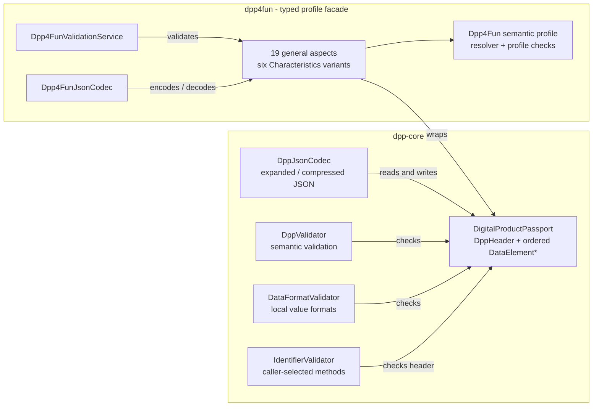

# DPP Data Model

`dpp-datamodel` contains two independently usable Maven artifacts: **`dpp-core`** for EN 18223-oriented passports, validation and JSON transport, and **`dpp4fun`** for immutable typed furniture views backed by the **same canonical core passport**. Neither artifact owns HTTP or database operations.



`dpp-core` owns `DigitalProductPassport`, its header and DataElements, along with the JSON codec and separate validators. `dpp4fun` depends on that core model to expose typed furniture views; its codec delegates to core transport and its validation service combines core and profile checks. Neither module requires HTTP clients or PostgreSQL.

## Dependencies

Use the artifact matching the product profile; `dpp4fun` already depends on `dpp-core`.

```xml
<dependency>
  <groupId>dpp.datamodel</groupId>
  <artifactId>dpp-core</artifactId>
  <version>${dpp.version}</version>
</dependency>
```

For the furniture profile use `dpp.datamodel:dpp4fun` instead. The [root README](../README.md#consumer-maven-artifacts) gives the current version.

## Generic EN core: quick example

```java
import dppsdk.core.model.*;
import dppsdk.core.validation.DppValidator;
import dppsdk.core.validation.format.DataFormatValidator;
import dppsdk.core.transport.json.DppJsonCodec;
import java.time.Instant;
import java.util.List;

var header = new DppHeader.Builder()
    .digitalProductPassportId("urn:example:dpp:item-1")
    .uniqueProductIdentifier("urn:example:product:item-1")
    .granularity(Granularity.ITEM)
    .dppSchemaVersion("EN18223:2026")
    .dppStatus("active")
    .lastUpdated(Instant.parse("2026-09-21T10:00:00Z"))
    .economicOperatorId("urn:example:operator:1")
    .build();
var dpp = new DigitalProductPassport.Builder()
    .dppHeader(header)
    .dataElements(List.of(new SingleValuedDataElement.Builder()
        .elementId("name").value("Chair").valueDataType("xsd:string").build()))
    .build();
var semantic = new DppValidator().validate(dpp);
var formats = new DataFormatValidator().validate(dpp);
if (!semantic.isValid() || !formats.isValid()) throw new IllegalStateException("Invalid DPP");
var codec = new DppJsonCodec();
String full = codec.toExpandedJson(dpp);
String compressed = codec.toCompressedJson(dpp);
var restored = codec.fromExpandedJson(full);
```

Identifier checks run **separately** through `IdentifierValidator` with a caller-selected `IdentifierValidationContext`; they do not infer a scheme from a string. These illustrative `urn:example` values are not a claim of a valid registered EN 18219 scheme.

## Furniture DPP4Fun: quick example

```java
import dppsdk.core.model.Granularity;
import dppsdk.dpp4fun.model.Dpp4Fun;
import dppsdk.dpp4fun.model.aspect.Nameplate;
import dppsdk.dpp4fun.model.characteristics.ChairCharacteristics;
import dppsdk.dpp4fun.model.unit.LengthUnit;
import dppsdk.dpp4fun.transport.Dpp4FunJsonCodec;
import dppsdk.dpp4fun.validation.Dpp4FunValidationService;
import java.net.URI;

var furniture = Dpp4Fun.builder()
    .digitalProductPassportId("urn:example:dpp:chair-1")
    .uniqueProductIdentifier("urn:example:product:chair-1")
    .granularity(Granularity.MODEL)
    .economicOperatorId("urn:example:operator:manufacturer")
    .dppStatus("active")
    .nameplate(Nameplate.builder().brand("Cir4Fun")
        .uriOfTheProduct(URI.create("https://example.test/chair-1")).build())
    .characteristics(ChairCharacteristics.builder()
        .length(125.0, LengthUnit.CENTIMETER)
        .surface("Smooth")
        .color("blue").build())
    .build();
var findings = new Dpp4FunValidationService().validate(furniture);
if (!findings.isValid()) throw new IllegalStateException(findings.issues().toString());
String full = new Dpp4FunJsonCodec().toExpandedJson(furniture);
```

The DPP4Fun facade preserves unknown core-representable fields during typed edits. Use `toBuilder()` for immutable updates. `Surface` is a descriptive String, not a numeric area; `ProfessionalUseOnly` is Boolean. DPP4Fun's versioned profile resolves available metadata but never fabricates missing dictionary references.

## Standards alignment at this module boundary

`dpp-core` implements the generic EN 18223 model, local semantic and format checks, and full/compressed JSON. Identifier validation covers a method-selected **subset** of EN 18219, not all accepted schemes or global issuance. DPP4Fun binds 19 general furniture aspects and six Characteristics variants to published D4.1/AAS examples.

Where the source materials disagree — multivalue cardinality, expanded-array naming, the `Surface` type — the chosen behavior and its evidence are recorded in the [model guide](MODEL_GUIDE.md#source-decisions-and-model-limitations).

## Where details live

- **[Model and Validation Guide](MODEL_GUIDE.md):** core class graph, the five DataElement variants, every D4.1 aspect and Characteristics variant, immutable editing, source and cardinality decisions, validation and identifier boundaries.
- **[Generic HTTP clients](../dpp-sdk-clients/README.md):** passing FULL or COMPRESSED JSON to a repository, response envelopes, updates, fine-granular operations.
- **[PostgreSQL persistence](../dpp-postgres/README.md):** versioned snapshots, projections, audit events.
- **[Runnable demo](../dpp-sdk-demo/README.md):** working service examples.

## Build and tests

Requires JDK 17. Run from the repository root; on Windows use `mvnw.cmd`. The `-am` flag pulls in the required reactor modules, so no prior install is needed.

```bash
./mvnw -f dpp-datamodel/pom.xml clean test                  # both modules
./mvnw -f dpp-datamodel/pom.xml clean install                # install both artifacts locally
./mvnw -f dpp-datamodel/pom.xml -pl dpp-core -am test        # one module only
```

**Scope:** data model, validators and codecs. No HTTP client, repository, lifecycle orchestration or certification guarantee.
