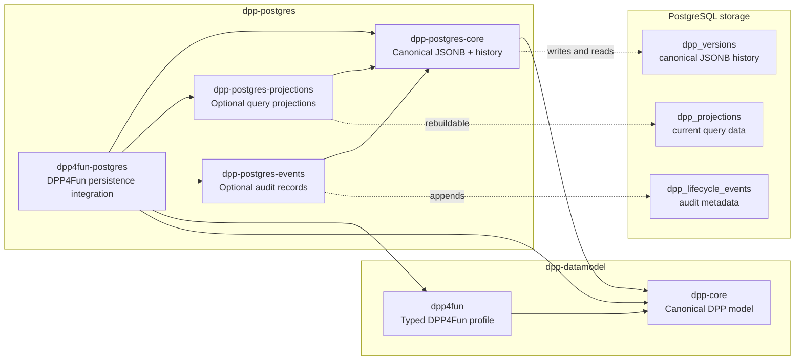
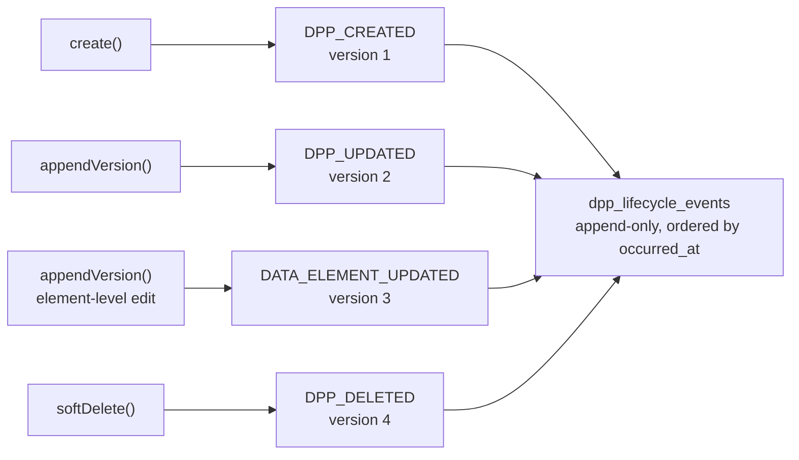
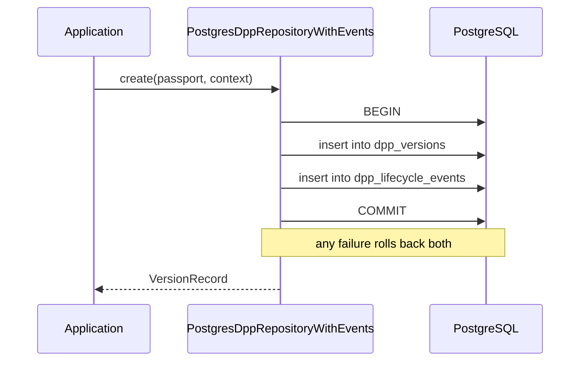

# DPP PostgreSQL

The PostgreSQL reactor stores complete, versioned canonical DPP JSONB snapshots and optionally adds query projections and change/audit records. It is the storage implementation, not the DPP model or HTTP client.

## Modules

| Module | Maven artifact | Responsibility |
| --- | --- | --- |
| `dpp-postgres-core` | `dpp.postgres:dpp-postgres-core` | Generic `DigitalProductPassport` snapshots, optimistic concurrency, history, point-in-time reads, and soft delete. |
| `dpp-postgres-projections` | `dpp.postgres:dpp-postgres-projections` | Optional generic current-state query documents and explicitly generated BTREE/GIN indexes. |
| `dpp-postgres-events` | `dpp.postgres:dpp-postgres-events` | Optional lightweight change/lifecycle audit records. |
| `dpp4fun-postgres` | `dpp.postgres:dpp4fun-postgres` | Dpp4Fun projection mapping, typed search, and convenient composition of core, projections, and events. |

Use `dpp-postgres-core` for generic canonical persistence. Add projections or
events when those capabilities are needed. `dpp4fun-postgres` brings the
datamodel, core persistence, projections, and events modules transitively.



Solid arrows point from a Maven module to its dependency; dashed arrows show storage operations. `dpp-postgres-core` depends on `dpp-core` and stores authoritative canonical JSONB revisions. Optional projections hold rebuildable current query data, optional lifecycle events hold audit metadata, and `dpp4fun-postgres` composes these modules for typed search and persistence.

## Source of truth

`dpp_versions.content` stores the complete expanded canonical DPP JSON through the frozen `DppJsonCodec`. Each revision can be reconstructed independently; appending a version closes the previous half-open validity interval `[valid_from, valid_to)` without rewriting its content.

`dpp_projections` contains a rebuildable current query representation. `dpp_lifecycle_events` contains SDK change/audit metadata. The Dpp4Fun projection is a profile-specific search optimization. None of these optional representations is needed to reconstruct canonical historical DPP content.

## Generic canonical persistence

Depend on `dpp.postgres:dpp-postgres-core`. Constructing `PostgresDppRepository` initializes the core tables using the module's existing bootstrap convention. Supply a canonical `DigitalProductPassport` and operation context:

```java
PostgresDppRepository repository = new PostgresDppRepository(dataSource);
PostgresDppOperationContext operation = PostgresDppOperationContext.now();

repository.create(passport, operation);
Optional<DigitalProductPassport> current =
        repository.findCurrentByDppId(passport.getDppHeader().getDigitalProductPassportId());
List<PostgresDppVersionRepositorySupport.VersionRecord> history =
        repository.findHistoryByDppId(dppId);
Optional<DigitalProductPassport> atTime = repository.findByDppIdAt(dppId, timestamp);

repository.appendVersion(updatedPassport, expectedVersion, PostgresDppOperationContext.now());
repository.softDelete(dppId, expectedVersion, Instant.now());
// Soft delete ends current lookup; revisions and point-in-time reads remain available.
```

Use the canonical header's DPP and product identifiers. `appendVersion` enforces the expected current version and does not create a new semantic revision when codec output is unchanged. `findVersion`, product-ID current/time reads, version-number lookup, existence checks, and paged active-ID lookup are also available. See `PostgresDppRepository` for the full API.

## Optional generic projections

Projection definitions extract a small JSON-safe document from any `DigitalProductPassport`; there is no reflection or inferred bean mapping. Declare only the indexes the query needs:

```java
DppProjectionDefinition definition = DppProjectionDefinition.builder("catalog")
        .extract(passport -> DppProjectionDocument.builder()
                .text("manufacturer", manufacturerFrom(passport))
                .number("rating", ratingFrom(passport))
                .strings("tags", tagsFrom(passport))
                .build())
        .btree("manufacturer", DppProjectionValueType.TEXT)
        .btree("rating", DppProjectionValueType.NUMBER)
        .gin("tags")
        .build();

PostgresProjectionDdlGenerator ddl = new PostgresProjectionDdlGenerator();
String tableDdl = ddl.createTableDdl();
String indexDdl = ddl.generate(definition);
new PostgresProjectionSchemaManager(dataSource).apply(definition); // explicit bootstrap
```

The extractor helpers above stand for application code that reads the canonical model. Projection storage supports upsert/find/remove and rebuilding a definition from every active canonical revision. Development and tests may explicitly call `PostgresProjectionSchemaManager.apply`; production can take deterministic output from `PostgresProjectionDdlGenerator` and apply it through its deployment process. Indexes are **not** created silently when a repository or application starts. Projection rows are current-state only and may be deleted and rebuilt without losing DPP data.

## Optional lifecycle/change events

Depend on `dpp.postgres:dpp-postgres-events`. Each write to a DPP can append an append-only audit record saying *what changed, to which revision, and when* — the trail you need to answer "who touched this passport and in what order" without reading every stored revision.



| Event type | Emitted by | `data` payload |
| --- | --- | --- |
| `DPP_CREATED` | `create` | `productId` |
| `DPP_UPDATED` | `appendVersion`, caller-selected | caller-supplied |
| `DATA_ELEMENT_UPDATED` | `appendVersion`, caller-selected | caller-supplied |
| `DPP_DELETED` | `softDelete` | `productId` |

`DPP_CREATED` and `DPP_DELETED` are recorded for you. For updates you pass the event type and `data` map, so an element-level edit is distinguishable from a whole-passport one.

### Events and revisions commit together

`PostgresDppRepositoryWithEvents` writes the revision and its event in **one transaction**. Either both land or neither does, so the audit trail cannot drift from the canonical history:



```java
PostgresDppRepositoryWithEvents repository = new PostgresDppRepositoryWithEvents(dataSource);
repository.initializeSchema(); // creates dpp_versions and dpp_lifecycle_events

var created = repository.create(passport, PostgresDppOperationContext.now());
repository.appendVersion(updatedPassport, created.versionNo(), PostgresDppOperationContext.now(),
        DppLifecycleEventType.DATA_ELEMENT_UPDATED, Map.of("path", "$.elements[1].elements[5]"));

List<DppLifecycleEventRecord> trail = repository.findEventsByDppId(dppId);
```

`findEventsByDppId` returns the trail ordered by `occurred_at` then `id`, so events with identical timestamps keep their insertion order. Each record carries `eventId`, `dppId`, `versionNo`, `operationId`, `eventType`, `occurredAt` and the `data` map. Share an `operationId` across writes to group them into one logical operation.

To drive the transaction yourself — for example to include a projection update — use `PostgresLifecycleEventRepository` directly; its methods take the `Connection`:

```java
PostgresLifecycleEventRepository events = new PostgresLifecycleEventRepository();
try (Connection connection = dataSource.getConnection()) {
    connection.setAutoCommit(false);
    try {
        events.append(connection, dppId, versionNo, operationId,
                DppLifecycleEventType.DPP_UPDATED, occurredAt, Map.of("reason", "changed"));
        connection.commit();
    } catch (SQLException | RuntimeException failure) {
        connection.rollback();
        throw failure;
    }
}
```

### Behavior worth knowing

- **No revision, no event.** `appendVersion` skips the event when the codec output is unchanged, because no new semantic revision was created. An update that changes nothing leaves no trace.
- `occurredAt` is truncated to **microseconds** to match PostgreSQL `timestamptz`, so a round-tripped nanosecond timestamp will not compare equal.
- `versionNo` and `operationId` are nullable; the shorter `append` overload omits both.
- `data` is a flat `Map<String, String>` stored as `jsonb`; a null map is stored as `{}`.
- Events are indexed on `(dpp_id, occurred_at, id)` — per-DPP history reads are the intended access path, not cross-DPP scans.

In the demo repository this is exposed through `DPP_REPO_EVENTS_ENABLED`; with events disabled, revisions, history and soft delete still work and the internal events endpoint returns 501.

EN 18223 addresses tracking and logging DPP changes. `dpp-postgres-events` is this SDK's concrete PostgreSQL representation for those records; its Java types and table format are not claimed to be prescribed by the standard. Records do not contain complete DPP content, actor identity, or a changed-property diff, and they are not event sourcing or the EN 18222 Lifecycle API.

## Dpp4Fun integration

Depend on `dpp.postgres:dpp4fun-postgres` for typed furniture profile behavior:

```java
Dpp4FunPostgresRepository repository = new Dpp4FunPostgresRepository(dataSource);
repository.initializeSchema(); // explicit development/test bootstrap
repository.create(dpp4fun, PostgresDppOperationContext.now());
List<Dpp4FunSearchResult> matches = repository.search(criteria);
Optional<Dpp4Fun> current = repository.findCurrentByDppId(dppId);
```

It maps Dpp4Fun values into the generic projection and composes canonical persistence, projection updates, and audit events in one transaction for create, version append, and soft delete. It does not store a second authoritative furniture graph. The current projection searches only the catalog-backed Nameplate brand and BillOfMaterials material, component, and part names; it does not project ontology-only sector/category fields or flatten multilingual product type/name fields into scalar columns.

## Schema and bootstrap

The core tables are `dpp_passports` (stable DPP/product identity) and `dpp_versions` (complete canonical revisions). Optional tables are `dpp_projections` and `dpp_lifecycle_events`. Schema resources:

- [`core-schema.sql`](dpp-postgres-core/src/main/resources/postgres/core-schema.sql)
- [`events-schema.sql`](dpp-postgres-events/src/main/resources/postgres/events-schema.sql)
- [`dpp4fun-schema.sql`](dpp4fun-postgres/src/main/resources/postgres/dpp4fun-schema.sql), containing the built-in Dpp4Fun projection indexes

No Flyway/Liquibase migration layer is included. Core repository construction retains core schema bootstrap; Dpp4Fun schema/index creation is explicit. Production online-index strategy belongs to deployment tooling.

## Standards alignment and limits

The PostgreSQL foundation stores complete versioned DPP snapshots, preserves historical revisions, and supports point-in-time lookup. It is designed around the storage and archiving concerns of EN 18221:2026. This is not a formal compliance or certification claim. EN 18222 concerns DPP lifecycle and search APIs; these PostgreSQL modules provide backend capabilities that can support such APIs but do not claim full API conformance. Projections are implementation query optimizations, not a standards information model or wire representation.

The foundation does not implement backup DPP service-provider integration, replication or an RPO schedule, external mandatory-document byte archival, or EN 18239 access-control enforcement. Canonical DPP references to related resources are retained in snapshots, but external resource bytes are not archived here. Content hashes are an implementation integrity aid; EN 18246 authentication, signature, and originality mechanisms are not claimed. No automatic revision purge is implemented; storage supports retention during the DPP lifetime, while regulatory lifetime policy/configuration remains outside this module.

## Build and test

Requires JDK 17, plus Docker for the Testcontainers integration tests. Run from the repository root; on Windows use `mvnw.cmd`. The PostgreSQL reactor is separate from the datamodel reactor, so install the datamodel artifacts first — `dpp4fun-postgres` needs its test JAR.

```bash
./mvnw -f dpp-datamodel/pom.xml clean install              # prerequisite
./mvnw -f dpp-postgres/pom.xml clean test                  # whole reactor
./mvnw -f dpp-postgres/pom.xml clean install               # install all artifacts locally
./mvnw -f dpp-postgres/pom.xml -pl dpp-postgres-core -am test   # one module only
```

Model→batch→item automatic inheritance and relational hierarchy management are **future work**, not part of this release.
