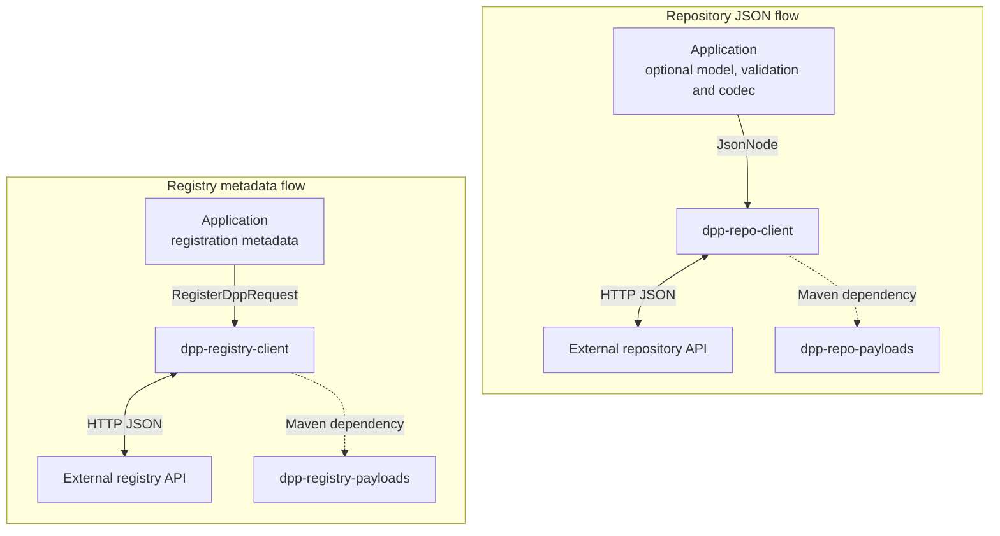

# DPP SDK Clients
## Purpose and model independence

`dpp-sdk-clients` provides generic Java HTTP clients and transport DTOs for DPP repository and registry APIs. Repository clients operate on JSON payloads. Domain validation and DPP encoding are handled by the datamodel/profile components before invoking the HTTP client.



The application may validate and encode a core or DPP4Fun passport before passing JSON to the repository client, and it may decode the JSON response afterward. Each generic HTTP client depends on its matching payload artifact and talks to its external API; neither client depends on the domain model. The registry request carries registration metadata, not a complete passport.

```xml
<dependency>
    <groupId>dpp.client</groupId>
    <artifactId>dpp-repo-client</artifactId>
    <version>${dpp.version}</version>
</dependency>

<dependency>
    <groupId>dpp.client</groupId>
    <artifactId>dpp-registry-client</artifactId>
    <version>${dpp.version}</version>
</dependency>
```

The [root README](../README.md#consumer-maven-artifacts) gives the current version. Each client brings its payload artifact transitively; depend on `dpp-repo-payloads` or `dpp-registry-payloads` directly only for DTOs without the HTTP clients.
## Payload DTOs without HTTP

The two `*-payloads` modules expose the request/response contracts independently of the HTTP clients. Use these only when another framework owns the transport. They contain no concrete domain model, validator or persistence code.
## Prepare JSON before repository calls

Use the datamodel/profile validator and codec before calling the HTTP client.
## Repository client setup

```java
import dpp.repo.client.HttpDppRepoClient;

var repoClient = new HttpDppRepoClient("http://localhost:8080");
```

The base URL must be an absolute HTTP or HTTPS URL with a host and is
normalized by removing trailing slashes.
## Registry client setup

```java
import dpp.registry.client.DppRegistryClient;
import dpp.registry.client.HttpDppRegistryClient;

// Registry registration uses metadata DTOs and needs no DPP codec or validator.
DppRegistryClient registryClient = new HttpDppRegistryClient("http://localhost:8081");
```

`HttpDppRegistryClient` also has a public `HttpDppRegistryClient(String, ObjectMapper)` constructor.
## Repository client API

`DppRepoClient` has the following public methods:

```java
CreateDppResponse createDpp(JsonNode dpp);
CreateDppResponse createDpp(JsonNode dpp, DppRepresentation representation);
DppApiResponse<JsonNode> readDppById(String dppId);
DppApiResponse<JsonNode> readDppById(String dppId, DppRepresentation representation);
DppApiResponse<JsonNode> readDppByProductId(String productId);
DppApiResponse<JsonNode> readDppByProductId(String productId, DppRepresentation representation);
DppApiResponse<JsonNode> readDppVersionByIdAndDate(String dppId, Instant date);
DppApiResponse<JsonNode> readDppVersionByIdAndDate(String dppId, Instant date, DppRepresentation representation);
ReadDppIdsResponse readDppIdsByProductIds(List<String> productIds, Integer limit, String cursor);
DppApiResponse<JsonNode> updateDppById(String dppId, JsonNode partialDpp);
DppApiResponse<JsonNode> updateDppById(String dppId, JsonNode partialDpp, DppRepresentation representation);
DeleteDppResponse deleteDppById(String dppId);
DppApiResponse<JsonNode> readDataElement(String dppId, String elementIdPath);
DppApiResponse<JsonNode> readDataElement(String dppId, String elementIdPath, DppRepresentation representation);
DppApiResponse<JsonNode> updateDataElement(String dppId, String elementIdPath, JsonNode dataElement);
DppApiResponse<JsonNode> updateDataElement(String dppId, String elementIdPath, JsonNode dataElement,
        DppRepresentation representation);
```

Create accepts a neutral `JsonNode`. The caller supplies JSON in the requested
representation; omitted/null representation and `COMPRESSED` omit the query
parameter, while `FULL` sends `representation=full`.

```java
import com.fasterxml.jackson.databind.ObjectMapper;
import com.fasterxml.jackson.databind.JsonNode;
import com.fasterxml.jackson.databind.node.ObjectNode;
import dpp.repo.payloads.CreateDppResponse;
import dpp.repo.payloads.DeleteDppResponse;
import dpp.repo.payloads.DppRepresentation;
import dppsdk.core.model.DigitalProductPassport;
import dppsdk.core.transport.json.DppJsonCodec;
import dppsdk.dpp4fun.model.Dpp4Fun;
import dppsdk.dpp4fun.transport.Dpp4FunJsonCodec;

ObjectMapper objectMapper = new ObjectMapper();
JsonNode prepared = objectMapper.readTree(new Dpp4FunJsonCodec().toJson(dpp));
CreateDppResponse created = repoClient.createDpp(prepared, DppRepresentation.FULL);
String createdDppId = created.getDigitalProductPassportId();
if (createdDppId == null)
    throw new IllegalStateException("Create response omitted the DPP ID; check the repository's ID contract");
var fullResponse = repoClient.readDppById(createdDppId, DppRepresentation.FULL);
DigitalProductPassport expanded = new DppJsonCodec().fromExpandedJson(fullResponse.getPayload().toString());
var header = new DppJsonCodec().readHeader(fullResponse.getPayload());
Dpp4Fun stored = Dpp4Fun.from(expanded);

// Merge-patch arrays replace the whole property. Build the changed profile,
// serialize it through the canonical codec, then patch its complete elements array.
Dpp4Fun changed = stored.toBuilder().nameplate(
        stored.getNameplate().toBuilder().brand("Updated via client").build()
).build();
ObjectNode patch = objectMapper.createObjectNode();
patch.set("elements", objectMapper.readTree(new Dpp4FunJsonCodec().toJson(changed)).get("elements"));

var updated = repoClient.updateDppById(
        stored.getDigitalProductPassportId(), patch, DppRepresentation.FULL);
DeleteDppResponse deleted = repoClient.deleteDppById(stored.getDigitalProductPassportId());
```

Delete returns an empty HTTP 204 response on the wire. `DeleteDppResponse` is a
Java-side convenience containing the synthesized `SuccessNoContent` status;
it is not parsed from a response body.

For object-root updates, the repository follows RFC 7396 JSON Merge Patch
behavior: `null` removes a property, nested objects merge recursively, and
arrays or other non-object values replace the existing value. The API accepts
object-root patches as `application/json`.
## Full and compressed reads

GET/PATCH default to COMPRESSED unless explicitly requested FULL. The client does not decode a DPP; use `DppJsonCodec` to read FULL payloads. Compressed expansion is best-effort because some metadata is omitted.

EN 18222 permits DPP payloads and create/registration identifiers to be absent on successful responses (cardinality 0..1). DPP operations preserve that optional payload in the response envelope; fine-granular DataElement responses require a non-null payload. Create and registration keep operation-specific results with status and their respective optional identifier.

```java
import com.fasterxml.jackson.databind.JsonNode;
import dppsdk.core.model.DigitalProductPassport;
import dppsdk.core.transport.json.DppJsonCodec;
import dpp.repo.payloads.DppApiResponse;
import dpp.repo.payloads.DppRepresentation;

DppApiResponse<JsonNode> compressed = repoClient.readDppById(dpp.getDigitalProductPassportId());
DppApiResponse<JsonNode> full = repoClient.readDppById(
        dpp.getDigitalProductPassportId(), DppRepresentation.FULL
);
DigitalProductPassport expanded = new DppJsonCodec().fromExpandedJson(full.getPayload().toString());
DigitalProductPassport bestEffort = new DppJsonCodec()
        .expandCompressedJson(compressed.getPayload().toString()).passport();
```
## Fine-granular operations

Fine-granular path support uses the documented singular JSONPath subset. Calls
without a representation use compressed operational values; pass
`DppRepresentation.FULL` to read or amend expanded DataElement JSON. The connected demo repository validates the complete DPP before persisting a revision. Unsupported
JSONPath features return a bodyless 501. The client percent-encodes the DPP ID
and element path.

```java
import com.fasterxml.jackson.databind.JsonNode;
import com.fasterxml.jackson.databind.node.ObjectNode;
import dpp.repo.payloads.DppRepresentation;

// Example path from the demo repository test sample; the method returns the selected DataElement JSON.
DppApiResponse<JsonNode> brand = repoClient.readDataElement(
        dpp.getDigitalProductPassportId(), "$.elements[1].elements[0]", DppRepresentation.FULL
);
((ObjectNode) brand.getPayload()).put("value", "Updated element value");
DppApiResponse<JsonNode> changed = repoClient.updateDataElement(
        dpp.getDigitalProductPassportId(),
        "$.elements[1].elements[0]",
        brand.getPayload(),
        DppRepresentation.FULL
);
```

The connected demo repository supports only this documented singular subset of
RFC 9535 JSONPath:

- root: `$`
- dot member selectors, for example `$.elements[3].elements[0]`
- quoted bracket member selectors, for example `$['elements'][4]`
- non-negative array indexes, for example `$.elements[4].elements[0].elements[0]`

It does not implement wildcards, descendants, unions, slices, filters, functions, or negative indexes. The endpoint returns HTTP 400 for malformed paths, HTTP 404 when a supported path selects no node, and HTTP 501 for a valid JSONPath feature outside that subset. Replacing the root is also a 400. The client parses structured API errors and otherwise preserves non-2xx responses as `DppHttpClientException`; it does not pre-evaluate paths.
## Registry registration

The only public registry-client method is `RegisterDppResponse postNewDppToRegistry(RegisterDppRequest request)`. It calls `POST /v1/registerDPP`.
`RegisterDppResponse` exposes the returned status code, optional `registrationId`,
and optional diagnostic `message` list.

```java
import dpp.registry.payloads.RegisterDppRequest;
import dpp.registry.payloads.RegisterDppResponse;

RegisterDppResponse registered = registryClient.postNewDppToRegistry(
        new RegisterDppRequest(
                dpp.getUniqueProductIdentifier(),
                dpp.getDigitalProductPassportId(),
                "operator-123",
                "http://localhost:8080"
        )
);
String registrationId = registered.getRegistrationId();
```

Outbound request JSON uses `uniqueProductIdentifier`, `digitalProductPassportId`, `uniqueEconomicOperatorIdentifier`, and `dppApiEndpoint`. The response field is `registrationId`. The DTOs accept legacy aliases (`productIdentifier`, `dppIdentifier`, `operatorIdentifier`, `repoUrl`, and `registryIdentifier`) during deserialization/source transition, but those names are not emitted as current JSON fields. The backup economic-operator identifier is not modeled by the current SDK or stored by the mock registry.

`dppApiEndpoint` has the EN `Uri` type. The mock registry validates URI syntax
and stores the endpoint as metadata; it does not resolve or contact it during
registration.
## Exception handling

Repository and registry clients have separate exception packages, even where
the simple class names are identical. Catch the `DppClientException` base class
from the client family being called, or catch a specific subtype:

- `DppApiClientException` for a structured API error, including non-2xx responses (exposes HTTP status, DPP status, messages, and raw body)
- `DppHttpClientException` for a non-2xx response that is not a structured API error (exposes HTTP status, raw body, and parsing cause)
- `DppMappingClientException` for JSON mapping failures or missing required response fields
- `DppNetworkClientException` for I/O or interrupted HTTP requests

```java
try {
    repoClient.createDpp(preparedJson);
} catch (dpp.repo.client.exception.DppClientException exception) {
    System.err.println(exception.getMessage());
}
```
## Endpoint coverage

| Public client method family | Route |
| --- | --- |
| Create, full/compressed read, update, delete | `/v1/dpps` and `/v1/dpps/{dppId}` |
| Full read by product ID | `/v1/dppsByProductId/{productId}` |
| Full historical read | `/v1/dppsByIdAndDate/{dppId}?date={instant}` |
| Batch ID lookup | `POST /v1/dppsByProductIds` |
| Fine-granular read/update | `/v1/dpps/{dppId}/elements/{elementIdPath}` |
| Registry registration | `POST /v1/registerDPP` |

The demo repository and registry expose internal/demo endpoints for health checks, events, and registry lookup. They are not public `dpp-sdk-clients` methods and are intentionally not documented as client operations here.
## Boundaries and standards alignment

These modules own generic HTTP, wrapper parsing, DTOs and exception mapping — not models, codecs, validators, persistence or demo runtime behavior. They provide no auth, retries, async API, cache or production-operational guarantee.

They implement **selected EN 18222:2026** API shapes, not a complete lifecycle specification, and only the singular RFC 9535 JSONPath subset documented above. EN Result uses `message` on output (legacy `messages` accepted on input); HTTP 501 has no Result body.
## Build and test

Requires JDK 17. Run from the repository root; on Windows use `mvnw.cmd`.

```bash
./mvnw -f dpp-sdk-clients/pom.xml clean test                     # whole reactor
./mvnw -f dpp-sdk-clients/pom.xml clean install                  # install all artifacts locally
./mvnw -f dpp-sdk-clients/pom.xml -pl dpp-repo-client -am test   # one module only
```

## Related documentation

- [DPP datamodel](../dpp-datamodel/README.md) — concrete `Dpp4Fun` model, codec, and validation
- [DPP demo](../dpp-sdk-demo/README.md) — runnable repository and registry services
- [Root README](../README.md) — Docker quick start and repository overview
