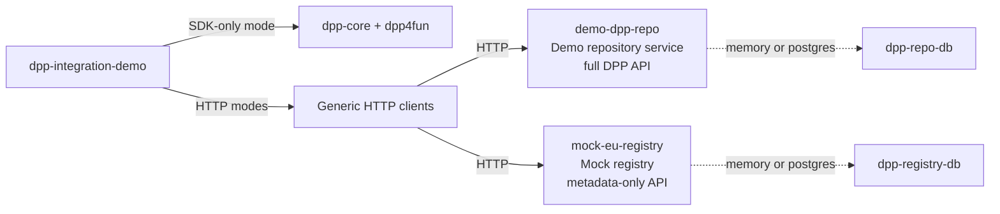

# DPP SDK Demo

A demo DPP repository service, a metadata-only mock registry, and a command-line integration demo. These demonstrate SDK behavior; they are not production deployments.

The repository is a working implementation: it validates with the SDK validators and persists canonical revisions through `dpp-postgres`, with history, point-in-time reads and soft delete. The registry is a stub standing in for a real EU registry — it stores the metadata it is handed and nothing more.

Both services expose the standardised EN 18222 API — the specified routes, operation names and result envelopes — so client code written against the standard runs against them unchanged. See [endpoint coverage](../dpp-sdk-clients/README.md#endpoint-coverage) for the implemented operations and [scope and limits](#scope-and-limits) for what is not covered.

This README owns setup and operations. For the presentation sequence, see [DEMO_GUIDE.md](DEMO_GUIDE.md).

Run all commands from the **repository root**. They use Bash/forward slashes, which also work in PowerShell; on Windows use `mvnw.cmd` where a command says `./mvnw`. JAR paths carry the current project version; adjust it after a version bump.

## How it fits together



The repository stores complete DPPs and their lifecycle history. The registry stores registration metadata and never contacts the repository. Each service has its own backend and database.

## Prerequisites

JDK 17, Docker with Compose v2, and internet access for Maven dependencies. The published-image quick start needs only Docker.

## Run the published images

`docker-compose.postgres.yml` starts the published repository and registry images with separate PostgreSQL databases. It has no `build:` entries — do not pass `--build`.

```bash
docker compose -f dpp-sdk-demo/docker-compose.postgres.yml up -d
docker compose -f dpp-sdk-demo/docker-compose.postgres.yml ps
```

The registry and tag default to the released GHCR images; override them with `DPP_IMAGE_REGISTRY` and `DPP_IMAGE_TAG` in [`.env`](.env.example). After changing the tag, `pull` before starting again. Other `.env` changes take effect when Compose recreates the containers.

## Build and run from this checkout

```bash
./mvnw -pl dpp-sdk-demo/dpp-integration-demo -am package
docker compose -f dpp-sdk-demo/docker-compose.yml up -d --build
```

Use `--build` after changing application code or Docker build inputs.

## Check the services

Both health endpoints return JSON with `status` `UP`:

| Service | Health | Swagger UI | OpenAPI JSON |
| --- | --- | --- | --- |
| Repository | <http://localhost:8080/health> | [/swagger-ui/index.html](http://localhost:8080/swagger-ui/index.html) | [/v3/api-docs](http://localhost:8080/v3/api-docs) |
| Registry | <http://localhost:8081/health> | [/swagger-ui/index.html](http://localhost:8081/swagger-ui/index.html) | [/v3/api-docs](http://localhost:8081/v3/api-docs) |

The API base URLs redirect to Swagger UI. Postman collections for lifecycle, fine-granular and registry requests are in [`postman/`](postman/); set their base URLs to your ports, as Postman does not read `.env`.

## Configuration

Compose reads `dpp-sdk-demo/.env` when run from the repository root. Copy [`.env.example`](.env.example) to `.env`, edit, then `up -d` again. Shell variables override `.env`. Keep credentials local; do not commit `.env`.

| Setting | Values | Effect |
| --- | --- | --- |
| `DPP_REPO_PROFILE` | `core`, `dpp4fun` (default) | `dpp4fun` adds profile-specific validation and seeds sample data. Both use the canonical passport model. |
| `DPP_REPO_BACKEND`, `DPP_REGISTRY_BACKEND` | `memory`, `postgres` | Memory data is lost when the process stops. Compose always uses PostgreSQL; local JAR runs default to memory. |
| `DPP_REPO_EVENTS_ENABLED` | `true` (default), `false` | Audit-event recording. Revisions, history and soft deletion stay available when disabled; the internal events endpoint then returns 501. |
| `DPP_REPO_PORT`, `DPP_REGISTRY_PORT` | default `8080`, `8081` | API ports. |
| `DPP_REPO_POSTGRES_PORT`, `DPP_REGISTRY_POSTGRES_PORT` | default `5433`, `5434` | PostgreSQL host ports. |

Changing the repository profile on an existing PostgreSQL dataset requires a migration or a fresh database.

For direct JAR runs, pass these as Spring command-line properties (see below) or environment variables.

## Run the integration demo

Build the JARs first (see above). Modes: `sdk` runs the SDK-only flow with no services; `http` needs both APIs running; `all` runs both flows.

```bash
java -jar dpp-sdk-demo/dpp-integration-demo/target/dpp-integration-demo-0.6.0.jar all --debug=false
java -jar dpp-sdk-demo/dpp-integration-demo/target/dpp-integration-demo-0.6.0.jar http http://localhost:8081 http://localhost:8080
```

HTTP mode checks both `/health` endpoints first. Optional service URLs are positional: `registryUrl` then `repoUrl`. `standards` is the default HTTP mode and `sdk-http` is an alias for `all`.

## Run the APIs without Docker

In-memory, one per terminal, after packaging:

```bash
java -jar dpp-sdk-demo/demo-dpp-repo/target/demo-dpp-repo-0.6.0-exec.jar --dpp.repo.backend=memory --server.port=8080
java -jar dpp-sdk-demo/mock-eu-registry/target/mock-eu-registry-0.6.0-exec.jar --dpp.registry.backend=memory --server.port=8081 --demo.repo.public-base-url=http://localhost:8080
```

To debug the API processes locally while keeping data in Docker, start just the databases and point the JARs at them. The credentials below are for this demo only.

```bash
docker compose -f dpp-sdk-demo/docker-compose.postgres.yml up -d dpp-repo-db dpp-registry-db

java -jar dpp-sdk-demo/demo-dpp-repo/target/demo-dpp-repo-0.6.0-exec.jar --dpp.repo.backend=postgres --spring.datasource.url=jdbc:postgresql://localhost:5433/dpp_repo --spring.datasource.username=dpp_repo --spring.datasource.password=dpp_repo --server.port=8080
java -jar dpp-sdk-demo/mock-eu-registry/target/mock-eu-registry-0.6.0-exec.jar --dpp.registry.backend=postgres --spring.datasource.url=jdbc:postgresql://localhost:5434/dpp_registry --spring.datasource.username=dpp_registry --spring.datasource.password=dpp_registry --server.port=8081 --demo.repo.public-base-url=http://localhost:8080
```

Records persist across JAR restarts while the database containers and volumes exist.

## Stop and clean

Use the same Compose file you started with.

```bash
docker compose -f dpp-sdk-demo/docker-compose.yml stop     # keeps containers and data
docker compose -f dpp-sdk-demo/docker-compose.yml down      # removes containers and network, keeps volumes
docker compose -f dpp-sdk-demo/docker-compose.yml down -v   # also deletes the volumes and all data in them
```

## Troubleshooting

- Inspect state and logs: `docker compose -f dpp-sdk-demo/docker-compose.yml ps` and `… logs --tail=100 dpp-repo-api dpp-registry-api`.
- Runner cannot connect: check both health URLs and the configured ports. In another network namespace, pass the registry URL and then the repository URL to the runner.
- A local JAR unexpectedly using PostgreSQL: set its backend explicitly with `--dpp.repo.backend=memory` or `--dpp.registry.backend=memory`.

## Scope and limits

Neither service establishes production security, operational readiness, registry interoperability or standards certification. The registry in particular is metadata-only and never contacts the repository. Fine-granular paths support root, member and index selection only: wildcards, descendants, unions, slices, filters, functions and negative indexes return 501, malformed paths return 400, and a valid path with no match returns 404.

## Tests

```bash
./mvnw -pl dpp-sdk-demo/dpp-integration-demo -am test
```

Generic HTTP client behavior is documented in the [client README](../dpp-sdk-clients/README.md).
